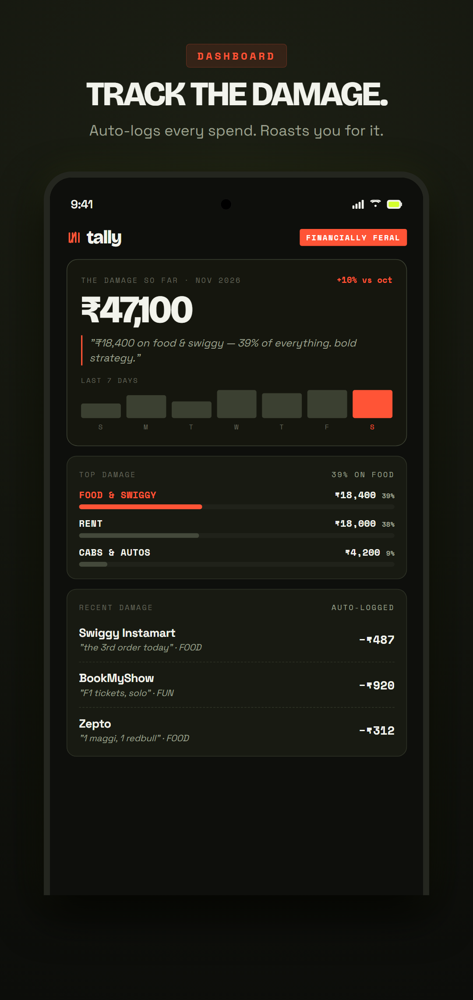
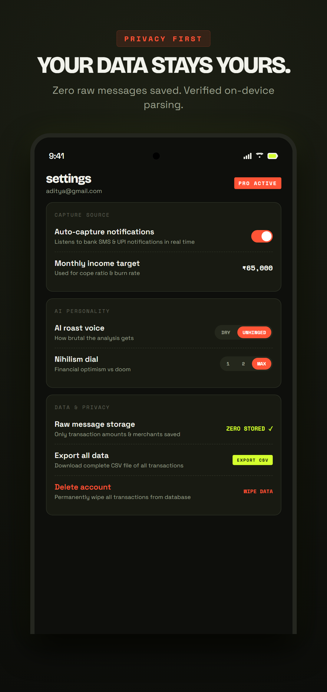

# Tally — track the damage.

<p align="center">
  
</p>

**Automatic expense tracking from your bank SMS & notifications.** Tally reads transaction alerts in the background, turns them into clean, categorized expenses with an unapologetic AI, and keeps your raw messages 100% private.

<p align="center">
  
  
  
</p>
<p align="center">
  
  
  
</p>

---

## What it does
- **Zero-effort tracking** — captures bank and UPI transaction alerts in the background (Android Notification Listener & Headless JS) and parses them into structured expenses, so you never log a transaction by hand.
- **AI categorization & roast** — an AI that tells you the truth about your spending habits, not a cheerful chart pretending everything is fine.
- **Privacy-first** — raw SMS/notifications aren't persisted; local on-device extraction, and in-app cascade account deletion.
- **Budgets vs Reality ("Delusions")** — set monthly limits per category and track your daily burn rate to payday.
- **Premium tier** — entitlement-based Pro (RevenueCat) with unlimited history, weekly roasts, and home-screen broke-streak widget.
- **Coming-soon landing** — Supabase-backed waitlist at `landing/`.

## Screenshots & Assets

| Screen | Raw Device (1080×2400) | Store Presentation Card (1080×2280) |
| :--- | :--- | :--- |
| **01 Dashboard** | [01_dashboard.png](docs/screenshots/raw/01_dashboard.png) | [store_01_dashboard.png](docs/screenshots/store/store_01_dashboard.png) |
| **02 Feed** | [02_feed.png](docs/screenshots/raw/02_feed.png) | [store_02_feed.png](docs/screenshots/store/store_02_feed.png) |
| **03 AI Roast / Insights** | [03_insights.png](docs/screenshots/raw/03_insights.png) | [store_03_insights.png](docs/screenshots/store/store_03_insights.png) |
| **04 Delusions / Budgets** | [04_budgets.png](docs/screenshots/raw/04_budgets.png) | [store_04_budgets.png](docs/screenshots/store/store_04_budgets.png) |
| **05 Tally Pro** | [05_pro.png](docs/screenshots/raw/05_pro.png) | [store_05_pro.png](docs/screenshots/store/store_05_pro.png) |
| **06 Settings & Privacy** | [06_settings.png](docs/screenshots/raw/06_settings.png) | [store_06_settings.png](docs/screenshots/store/store_06_settings.png) |
| **Play Store Feature Graphic** | [feature_graphic.png (1024×500)](docs/screenshots/feature_graphic.png) | — |

Screenshots can be regenerated anytime with:
```bash
python scripts/generate_screenshots.py
```

## Stack
React Native (Expo SDK 56) · Supabase (Postgres) · server-side AI parsing (Anthropic) · RevenueCat · EAS Build

## Getting started
```bash
npm install
cp .env.example .env
npx expo start
```
> Background capture uses native modules, so run a **development build** (EAS) — not Expo Go.

See [PRIVACY.md](PRIVACY.md), [DEPLOY.md](DEPLOY.md), and [docs/STORE_LISTING.md](docs/STORE_LISTING.md) for details.

## Status
In active development · prepping for Google Play Store release.

---
<sub>Confirm the exact run/build scripts in `package.json` / `eas.json` before publishing.</sub>
