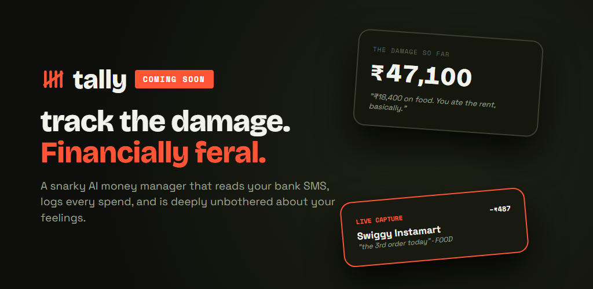
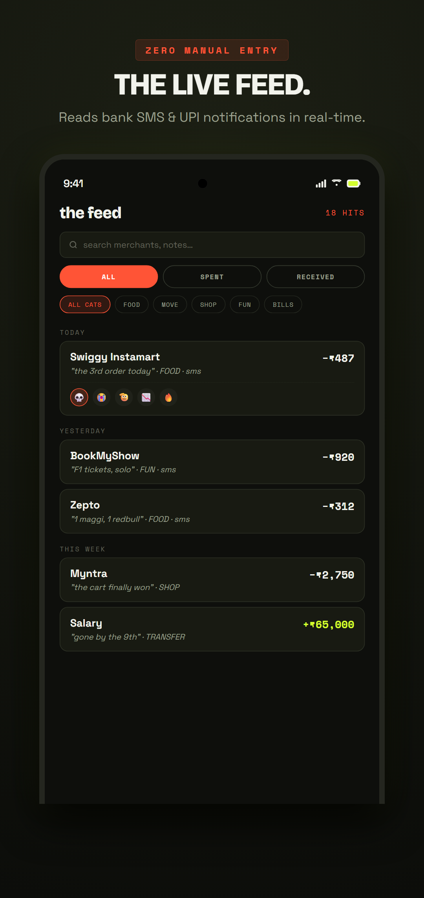
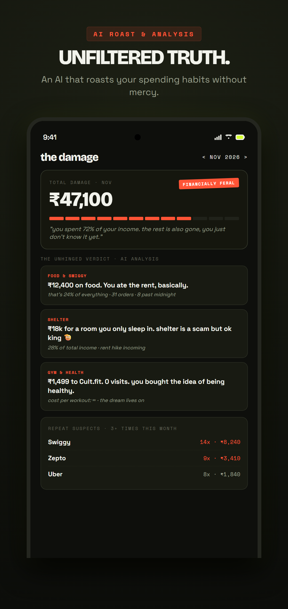
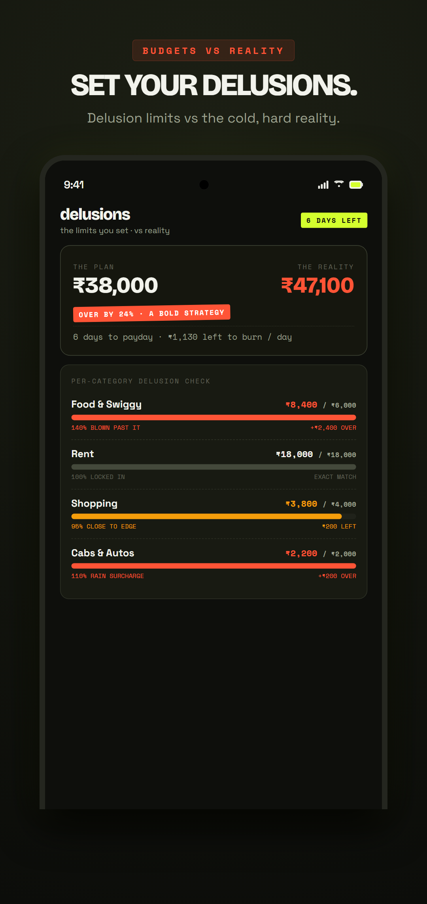
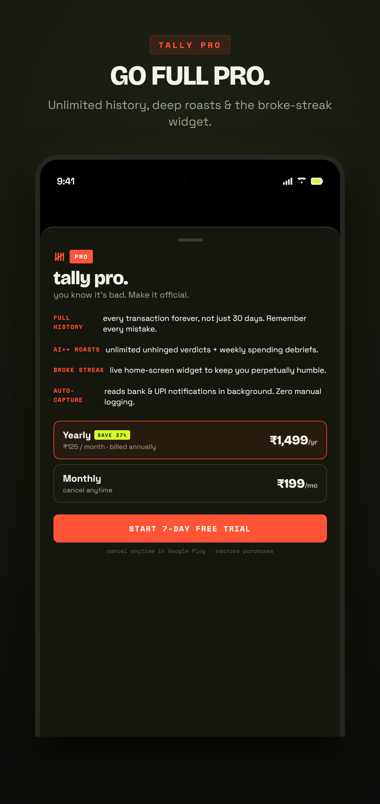

# Tally · track the damage.

<p align="center">
  
</p>

**Expense tracking from supported bank SMS and notifications.** Tally parses transaction alerts into categorized expenses. It stores extracted transaction details; ambiguous alerts may send a short text snippet to the AI provider for categorization.

<p align="center">
  
  
  
</p>
<p align="center">
  
  
  
</p>

---

## What it does
- **Automatic capture**: parses supported bank and UPI transaction alerts in the background when the relevant permission and alerts are available; manual entry covers missing alerts.
- **AI categorization & roast**: an AI that tells you the truth about your spending habits, not a cheerful chart pretending everything is fine.
- **Privacy-first**: raw SMS/notifications aren't persisted; local on-device extraction, and in-app cascade account deletion.
- **Budgets vs Reality ("Delusions")**: set monthly limits per category and track your daily burn rate to payday.
- **Account grouping**: label captured transactions by bank name and the last four digits shown in alerts; no full card number or direct bank connection.
- **Premium tier**: entitlement-based Pro (RevenueCat) with full history, purchase planning, 50 interactive AI calls per day instead of 10, receipt sharing, and a home-screen broke-streak widget. Alert categorisation is available to everyone and has a separate abuse limit.
- **Coming-soon landing**: Supabase-backed waitlist at `landing/`.

## Stack
React Native (Expo SDK 56) · Supabase (Postgres) · server-side AI parsing (Anthropic) · RevenueCat · EAS Build

## Getting started
```bash
npm install
cp .env.example .env
npx expo start
```
> Background capture uses native modules, so run a **development build** (EAS) (not Expo Go).

See [PRIVACY.md](PRIVACY.md), [DEPLOY.md](DEPLOY.md), and [docs/STORE_LISTING.md](docs/STORE_LISTING.md) for details.

## Status
In active development · prepping for Google Play Store release.

---
<sub>Confirm the exact run/build scripts in `package.json` / `eas.json` before publishing.</sub>
